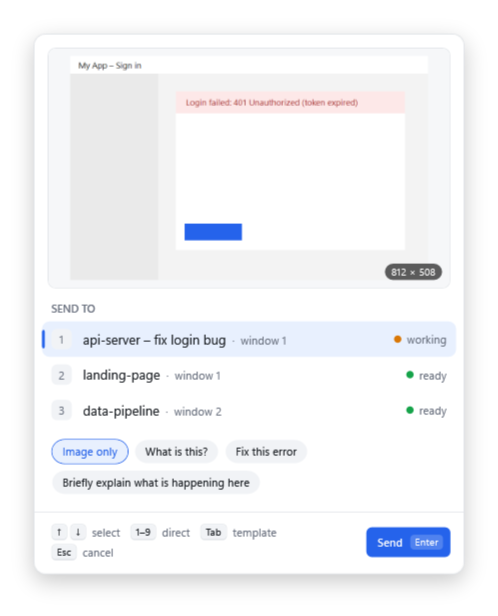
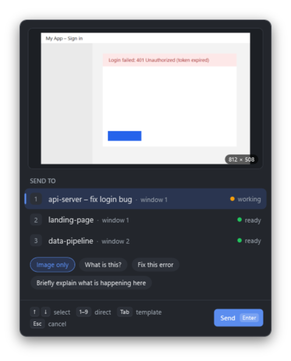
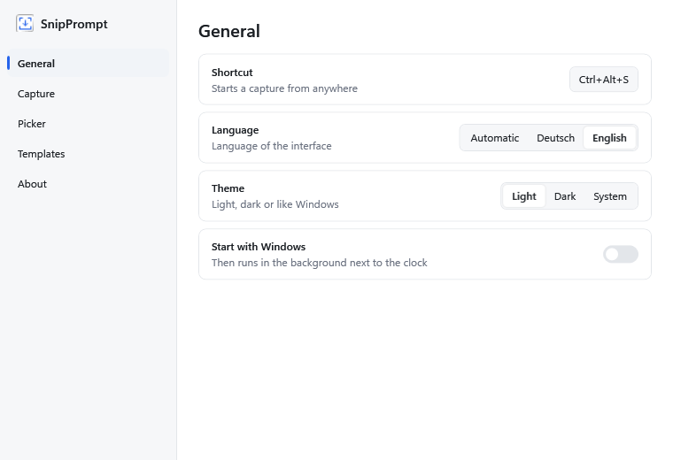

<div align="center">


# SnipPrompt

**Snip a screen area and drop it straight into the Claude Code session you pick – one shortcut, no copy & paste.**


-512BD4)


[Deutsch](README.de.md) · [Quick start](#-quick-start) · [Features](#-features) · [Settings](#%EF%B8%8F-settings) · [Known limits](#-known-limits)


</div>

## Why

Showing Claude Code what you see usually means: open the Snipping Tool, capture, copy, switch to the terminal, paste.
SnipPrompt turns that into **one shortcut and one drag**. It lives next to the clock, finds your Claude Code sessions
in Windows Terminal and pastes the screenshot into the one you choose – ready for your question.

## ✨ Features

- **One shortcut** (`Ctrl+Alt+S`, configurable), a click on the tray icon or on the pinned taskbar icon
- **Frame or window mode** – drag a rectangle across all monitors, or click a window
- **Mark it up** – hold `Shift` while capturing to draw rectangles, arrows, highlights and text (`Ctrl+Z` to undo)
- **Session picker** – large preview, live status per session (*working* / *ready*), last used session preselected,
  digits `1–9` to send instantly. With only one Claude Code session open, it pastes directly
- **Text templates** – optionally add "What is this?" or your own one-liners after the image
- **Delay** – 1/2/3/5 s *after* choosing the area, to open a menu or tooltip inside it
- **Never presses Enter** – you review the prompt and send it yourself
- **Light, dark or system theme**, **English and German** interface, optional start with Windows
- **No install, no dependencies** – built with the C# compiler that ships with Windows

<table>
  <tr>
    <td></td>
    <td></td>
  </tr>
  <tr>
    <td colspan="2"></td>
  </tr>
</table>

## 🚀 Quick start

Requirements: Windows 10/11, [Windows Terminal](https://aka.ms/terminal) and Claude Code running inside it.

```powershell
git clone https://github.com/rofldark/snipprompt.git
cd snipprompt
powershell -ExecutionPolicy Bypass -File build.ps1
bin\SnipPrompt.exe
```

The icon appears next to the clock and the first capture starts right away.
Optional: right-click `bin\SnipPrompt.exe` → *Pin to taskbar*, and enable *Start with Windows* in the settings.

### How it works

1. Press `Ctrl+Alt+S` (or click the tray / taskbar icon).
2. Drag a frame – or click a window in window mode. `Esc` or right click cancels.
   Hold `Shift` while releasing to mark things up first.
3. One Claude Code session open → pasted immediately. Several → pick one (`↑ ↓` + `Enter`, `1–9`, double click,
   or the *Send* button); `Tab` cycles through the templates.
4. Type your question and press `Enter` yourself.

## ⚙️ Settings

Right-click the tray icon → *Settings*. Every change is saved immediately.

| Section | Options |
|---|---|
| General | Shortcut · Language (Automatic / Deutsch / English) · Theme (Light / Dark / System) · Start with Windows |
| Capture | Frame or window · Delay (off / 1 / 2 / 3 / 5 s) · Annotate with Shift · Keep copies (none / 20 / 100) |
| Picker | Show preview · Preselect last session · Send directly when there is only one session · Show templates |
| Templates | Your own single-line texts, typed after the image |

Settings live in `%APPDATA%\SnipPrompt\settings.json`, screenshot copies in `%LOCALAPPDATA%\SnipPrompt\`.

## 🛡️ Safety rules

SnipPrompt sends keystrokes to another program, so it is strict about where they go:

- keys are only sent when the target window is in front **and** the target tab is selected
- tabs that don't look like Claude Code are never pasted into without asking
- it waits until `Enter`, `Shift`, `Ctrl`, `Alt` and `Win` are released – a held key can't send your prompt
- it never presses `Enter`; templates are single-line and control characters are stripped
- if anything is off, nothing is typed: the image stays on the clipboard (`Alt+V` by hand) and a notice appears

## 📌 Known limits

- Windows Terminal only (no classic console, no VS Code terminal yet).
- Claude Code sessions are recognised by the status mark Claude Code puts in front of the tab title
  (`✳` when idle, a spinner while working). If that format changes, recognition needs an update (`Logic.Markers`).
- If Claude Code reads the clipboard slowly, a template may end up in front of the `[Image #1]` placeholder.
- The executable is not code-signed; Windows SmartScreen may ask once.

## 🧪 Development

```powershell
powershell -ExecutionPolicy Bypass -File build.ps1 -Test     # unit tests (logic, settings, translations)
bin\SnipPrompt.exe --list                                     # which terminal tabs are detected (* = Claude Code)
bin\SnipPrompt.exe --snapshots <folder> [en|de]               # render picker and settings to PNG files
bin\SnipPrompt.exe --grab-check                               # take a screenshot in memory and report its size
```

C# 5 / WPF on .NET Framework 4.x, compiled with the built-in `csc.exe` – no SDK, no NuGet packages.
All UI texts are in `src/Strings.cs` (one row per key, German and English side by side).

## ⚖️ Legal

SnipPrompt is an independent open-source project. It is not affiliated with, endorsed by or sponsored by Anthropic.
"Claude" and "Claude Code" are trademarks of Anthropic. Inspired by PaneDrop for macOS.

## 📄 License

[MIT](LICENSE) © 2026 rofldark
